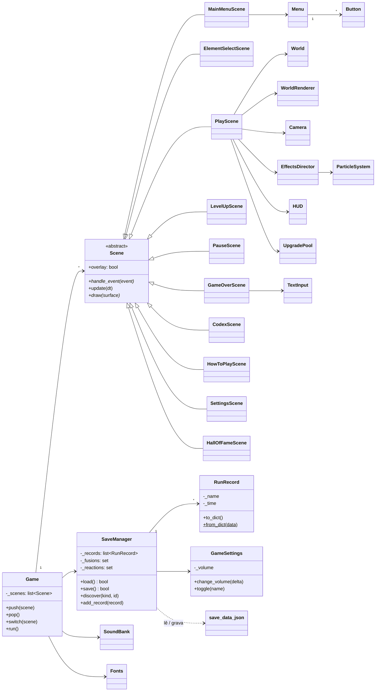

# Elemental Chaos

Roguelike de sobrevivência 2D, visto de cima, feito em **Python + Pygame** para o projeto final de
**Programação com Objectos**.

Sobrevive a vagas de inimigos cada vez mais fortes. Os ataques são automáticos: tu escolhes o
caminho e as melhorias. O que torna o jogo diferente é o **sistema elemental**:

- **Reações elementais**: um inimigo Molhado atingido por um Raio conduz eletricidade para os vizinhos,
  um inimigo Congelado atingido por Terra estilhaça, e há mais para descobrir.
- **Fusões elementais**: quando tens dois elementos ao nível 2, podem fundir-se numa habilidade nova
  e muito mais forte (Tornado de Fogo, Chuva de Meteoros, Nevasca, …).
- **Codex Elemental**: tudo o que descobres fica guardado entre partidas.

---

## 1. Instalação

Requisitos: **Python 3.9 ou mais recente**.

```bash
pip install -r requirements.txt
```

O `requirements.txt` instala o **pygame-ce**, uma versão do pygame mantida pela comunidade que tem
pacotes prontos para as versões recentes do Python (incluindo 3.13 e 3.14). Usa-se exatamente como o
pygame (`import pygame`). Em Python ≤ 3.12 também funciona com o pygame "clássico" (`pip install pygame`).
Não instalem os dois ao mesmo tempo.

## 2. Executar

```bash
python main.py
```

No Windows, se `python` não for reconhecido, usem `py main.py`.

Testes automáticos (não abrem janela):

```bash
python -m unittest discover tests
```

## 3. Controlos

| Ação | Teclas |
|---|---|
| Mover | `W` `A` `S` `D` ou setas |
| Atacar | automático |
| Pausa | `Esc` ou `P` (o jogo também pausa sozinho se a janela perder o foco) |
| Escolher melhoria | `1` `2` `3`, setas + `Enter`, ou clique |
| Menus | setas + `Enter`, ou rato |

## 4. Como se joga

1. Escolhe o **elemento inicial** (ou *Random*).
2. Os inimigos aparecem à tua volta e largam **cristais de XP**. Apanha-os para subir de nível.
3. Em cada nível escolhes **1 de 3 cartas** de melhoria, com raridade
   *Common*, *Rare*, *Epic* ou *Legendary* (quanto mais rara, mais forte e menos frequente).
4. A cada **5 minutos** aparece um **boss** com vários padrões de ataque. Ao morrer deixa um
   **Núcleo Elemental**: cura total e uma escolha garantida *Epic* ou melhor.
5. Quando morres vês o resumo da partida e podes gravar o teu nome no **Hall of Fame**.

### Elementos

| Elemento | Ataque | Efeito | Melhoria própria |
|---|---|---|---|
| Fogo | Bolas de fogo que explodem | **Burning** (dano ao longo do tempo) | Dano de fogo |
| Água | Projéteis perfurantes | **Wet** | Duração do Wet |
| Raio | Raio instantâneo em cadeia | **Electrified** (+20% dano recebido) | Nº de saltos |
| Gelo | Leque de estilhaços | **Slowed**; 3 acertos → **Frozen** | Duração do abrandamento |
| Terra | Pedregulhos pesados | Muito dano e empurrão | Força do empurrão |
| Vento | Lâminas rápidas na direção do movimento | Perfuram vários inimigos | Velocidade das lâminas |

### Reações (automáticas)

| Estado no inimigo | + Elemento | Reação |
|---|---|---|
| Wet | Raio | **Conduction**: a eletricidade salta para até 5 inimigos |
| Burning | Vento | **Wildfire**: o fogo espalha-se aos vizinhos |
| Frozen | Terra | **Shatter**: dano ×2,5 e explosão de gelo |
| Wet | Gelo | **Flash Freeze**: congela instantaneamente |
| Burning | Água | **Steam Burst**: nuvem de vapor que causa dano |
| Burning | Raio | **Overload**: explosão de fogo |
| Frozen | Fogo | **Melt**: dano ×2 |

### Fusões

Uma fusão só aparece nas cartas quando o jogador tem **os dois elementos ao nível 2 ou mais**.
Os elementos base continuam a funcionar, podes ter várias fusões ao mesmo tempo e cada uma pode ser
melhorada (dano, cooldown, área e quantidade).

| Combinação | Fusão | Efeito |
|---|---|---|
| Fogo + Vento | Fire Tornado | Tornados que queimam e puxam inimigos |
| Fogo + Terra | Meteor Shower | Meteoros com explosão e cratera a arder |
| Fogo + Água | Steam Explosion | Explosão no maior grupo + nuvem de vapor |
| Água + Raio | Electric Storm | Chuva molha os inimigos; os molhados conduzem arcos entre si |
| Água + Gelo | Blizzard | Tempestade gelada à volta do jogador |
| Terra + Raio | Magnetic Field | Junta os inimigos e depois descarrega |
| Terra + Vento | Sandstorm | Grande zona de areia em movimento |
| Gelo + Terra | Crystal Spikes | Linhas de cristais a sair do chão |
| Gelo + Raio | Frozen Thunder | Raios que congelam; o Raio base passa a arrefecer |
| Vento + Raio | Thunderstorm | Nuvem que lança raios dentro da sua área |

### Inimigos

Básico (muitos e lentos) · Rápido · Tanque (muita vida) · À distância (mantém distância e dispara) ·
Elite (brilhante, investe contra o jogador, dá muito XP) · Boss (barra de vida, 5 padrões, fica
furioso abaixo de 50% da vida).
A dificuldade (frequência, vida, velocidade e variedade) sobe de forma contínua, sem saltos bruscos.

---

## 5. Requisitos do enunciado

| # | Requisito | Onde está no código |
|---|---|---|
| **R1** | Classes e encapsulamento | Mais de 60 classes próprias. Os atributos são internos (`_hp`, `_pos`, `_level`…) e só mudam pelos métodos da própria classe: `Enemy.take_damage()`, `Player.heal()`, `PlayerStats.improve()`, `Element.level_up()`, `GameSettings.toggle()`… Os outros objetos leem através de `@property` (só de leitura; `pos` devolve uma cópia). |
| **R2** | Herança e polimorfismo | Várias hierarquias com métodos redefinidos: `Enemy.behave()` (6 subclasses), `Element.fire()` (6), `Fusion.activate()` (10), `AreaEffect.on_tick()/move()` (9), `Reaction.trigger()` (7), `StatusEffect.tick()/speed_multiplier()` (5), `Upgrade.apply()` (7), `Pickup.on_collect()` (4), `Projectile.on_hit()` (6), `Scene.handle_event()/draw()` (10). O `World` chama `enemy.update()` sem saber se é um Tanque ou um Boss. |
| **R3** | Coleção de objetos + ficheiro | O `World` guarda listas de objetos (inimigos, projéteis, zonas, pickups) e o `Player` guarda dicionários `{id: Element}` / `{id: Fusion}`. O `SaveManager` grava e lê o ficheiro **`save_data.json`** com o Codex, a lista de objetos `RunRecord` (Hall of Fame) e as definições. |
| **R4** | Robustez e documentação | Ficheiro de gravação corrompido ou com valores inválidos → é recuperado sem crash (backup em `save_data.corrupt.json`). O nome no Game Over só aceita letras, números, espaço, `-` e `_`, até 12 caracteres, e mostra uma mensagem de erro. Sem placa de som o jogo corre em silêncio. Teclas desconhecidas são ignoradas. Pausa automática quando a janela perde o foco. As escolhas de melhoria ignoram teclas durante 0,35 s (para não escolher uma carta sem querer). Erro inesperado → `crash.log`. README, diagrama de classes e 21 testes automáticos. |

**Criatividade / para além das aulas:** classes abstratas (`abc`), máquina de estados para os ecrãs,
gravação em JSON, sistema de eventos (lógica separada da apresentação), grelha espacial para
colisões, fusões *data-driven*, som e gráficos 100% gerados por código.

## 6. Arquitetura

```
 Lógica (sem desenho)                         Apresentação (sem regras)
 ─────────────────────                        ─────────────────────────
 World ── Player ── Element / Fusion          Game (janela + ciclo principal)
   │        └── PlayerStats                     └── pilha de Scene (máquina de estados)
   ├── Enemy (+ WaveDirector)                         └── PlayScene
   ├── Projectile, AreaEffect, Pickup                       ├── WorldRenderer + Camera
   ├── ReactionSystem ── Reaction                           ├── EffectsDirector (partículas, números, som)
   ├── SpatialGrid                                          └── HUD
   └── EventQueue ───── GameEvent ─────────────────────────────▶ lidos pelo EffectsDirector
```

- A lógica **nunca desenha**: emite `GameEvent`s ("inimigo atingido aqui", "reação ali").
  O `EffectsDirector` transforma-os em partículas, números de dano, tremor de ecrã e sons.
- **Delta time** em todos os movimentos (e limitado a 1/20 s para evitar saltos).
- **SpatialGrid**: as colisões só testam inimigos das células próximas. Com 300 inimigos a
  lógica demora cerca de 3 ms por frame.
- **Data-driven**: as fusões são uma tabela (`FUSION_RECIPES` em `fusions.py`).

### Como adicionar uma nova fusão

1. Em `fusions.py`, escrever uma subclasse de `Fusion` com o método `activate(world, player)`
   (ou reutilizar uma existente com outros números).
2. Acrescentar uma linha `FusionRecipe(...)` a `FUSION_RECIPES` com os dois elementos.

Não é preciso mudar mais nada: as cartas de melhoria, o HUD, o Codex e a gravação usam a tabela.

## 7. Estrutura dos ficheiros

| Ficheiro | Conteúdo |
|---|---|
| `main.py` | Ponto de entrada; trata erros inesperados |
| `game.py` | `Game`: janela, ciclo principal, pilha de cenas |
| `scenes.py` | Ecrãs: menu, escolha de elemento, jogo, level-up, pausa, game over, codex, ajuda, definições, hall of fame |
| `settings.py` | Constantes e valores de equilíbrio |
| `world.py` | `World`: uma partida (coleções de objetos, colisões, dano, descobertas) |
| `player.py` | `Player`, `PlayerStats` |
| `elements.py` | `Element` e os 6 elementos |
| `fusions.py` | `Fusion`, as 10 fusões e a tabela `FUSION_RECIPES` |
| `zones.py` | `AreaEffect`: tornados, tempestades, meteoros, vapor… |
| `reactions.py` | `Reaction`, as 7 reações e o `ReactionSystem` |
| `status.py` | Estados (`Burning`, `Wet`, `Frozen`, `Slowed`, `Electrified`) e `StatusSet` |
| `enemies.py` | `Enemy`, os 6 tipos e o `WaveDirector` |
| `projectiles.py` | Projéteis do jogador e dos inimigos |
| `pickups.py` | Cristais de XP, cura, íman, núcleo do boss |
| `upgrades.py` | Raridades, cartas de melhoria e `UpgradePool` |
| `save_manager.py` | `SaveManager`, `RunRecord`, `GameSettings` (JSON) |
| `events.py` | `GameEvent`, `EventQueue` |
| `spatial.py` | `SpatialGrid` |
| `renderer.py` | `Camera`, `WorldRenderer` |
| `particles.py` | Partículas, números de dano, `EffectsDirector` |
| `ui.py` | Fontes, botões, menus, caixa de texto, ícones, HUD, cartas |
| `gfx.py` | Utilitários de desenho (brilhos, círculos translúcidos) |
| `audio.py` | `SoundBank`: sons sintetizados por código |
| `tests/` | Testes automáticos (`unittest`) |

## 8. Diagrama de classes

O GitHub (e o VS Code com uma extensão Mermaid) mostra os diagramas abaixo como imagens.
Seta com triângulo = herança; seta normal = "tem / usa".

### Lógica do jogo

```mermaid
classDiagram
    direction LR
    class World {
        -_enemies: list~Enemy~
        -_projectiles: list~Projectile~
        -_effects: list~AreaEffect~
        -_pickups: list~Pickup~
        +update(dt, direction)
        +damage_enemy(enemy, amount, element)
        +explode(pos, radius, damage, element)
        +chain_lightning(...)
        +summary() dict
    }
    class Player {
        -_hp
        -_elements: dict~str, Element~
        -_fusions: dict~str, Fusion~
        +move(direction, dt)
        +take_damage(amount) bool
        +add_xp(amount) int
        +add_element(id)
        +add_fusion(recipe)
    }
    class PlayerStats {
        -_damage_mult
        -_move_speed
        +improve(stat, amount)
    }
    class Element {
        <<abstract>>
        -_level
        +update(dt, world, player)
        +fire(world, player)*
        +improve_special(power)
    }
    class Fusion {
        <<abstract>>
        -_recipe: FusionRecipe
        +upgrade(stat, power)
        +activate(world, player)*
    }
    class FusionRecipe {
        +elements: frozenset
        +is_eligible(player) bool
        +create() Fusion
    }
    class Enemy {
        <<abstract>>
        -_hp
        -_statuses: StatusSet
        +take_damage(amount)
        +apply_status(effect)
        +behave(dt, world, mult)
        +on_death(world)
    }
    class StatusEffect {
        <<abstract>>
        +tick(dt)
        +speed_multiplier()
    }
    class Reaction {
        <<abstract>>
        +matches(enemy, element)
        +trigger(world, enemy, damage)*
    }
    class Projectile {
        +update(dt)
        +on_hit(enemy, world)
    }
    class AreaEffect {
        <<abstract>>
        +update(dt, world)
        +move(dt, world)
        +on_tick(world)
    }
    class Pickup {
        <<abstract>>
        +on_collect(player, world)*
    }
    class Upgrade {
        <<abstract>>
        +title()*
        +description()*
        +apply(player, world)*
    }

    World "1" --> "1" Player
    World "1" --> "*" Enemy
    World "1" --> "*" Projectile
    World "1" --> "*" AreaEffect
    World "1" --> "*" Pickup
    World --> ReactionSystem
    World --> WaveDirector
    World --> SpatialGrid
    World --> EventQueue
    Player --> PlayerStats
    Player "1" --> "*" Element
    Player "1" --> "*" Fusion
    Fusion --> FusionRecipe
    Enemy --> StatusSet
    StatusSet "1" --> "*" StatusEffect
    ReactionSystem "1" --> "*" Reaction
    UpgradePool ..> Upgrade : cria

    Element <|-- FireElement
    Element <|-- WaterElement
    Element <|-- LightningElement
    Element <|-- IceElement
    Element <|-- EarthElement
    Element <|-- WindElement
    Enemy <|-- BasicEnemy
    Enemy <|-- FastEnemy
    Enemy <|-- TankEnemy
    Enemy <|-- RangedEnemy
    Enemy <|-- EliteEnemy
    Enemy <|-- BossEnemy
    StatusEffect <|-- Burning
    StatusEffect <|-- Wet
    StatusEffect <|-- Frozen
    StatusEffect <|-- Slowed
    StatusEffect <|-- Electrified
    Reaction <|-- Conduction
    Reaction <|-- Wildfire
    Reaction <|-- Shatter
    Reaction <|-- FlashFreeze
    Reaction <|-- SteamBurst
    Reaction <|-- Overload
    Reaction <|-- Melt
    Projectile <|-- Fireball
    Projectile <|-- WaterBolt
    Projectile <|-- IceShard
    Projectile <|-- Rock
    Projectile <|-- WindBlade
    Projectile <|-- EnemyBullet
    Pickup <|-- XPGem
    Pickup <|-- HealOrb
    Pickup <|-- Magnet
    Pickup <|-- ElementalCore
    Upgrade <|-- StatUpgrade
    Upgrade <|-- NewElementUpgrade
    Upgrade <|-- ElementLevelUpgrade
    Upgrade <|-- ElementSpecialUpgrade
    Upgrade <|-- FusionUnlockUpgrade
    Upgrade <|-- FusionStatUpgrade
    Upgrade <|-- HealUpgrade
```



As 10 subclasses de `Fusion` (`FireTornadoFusion`, `MeteorShowerFusion`, `SteamExplosionFusion`,
`ElectricStormFusion`, `BlizzardFusion`, `MagneticFieldFusion`, `SandstormFusion`,
`CrystalSpikesFusion`, `FrozenThunderFusion`, `ThunderstormFusion`) e as 9 de `AreaEffect`
(`SteamCloud`, `FireTornado`, `Meteor`, `ElectricStormAura`, `BlizzardAura`, `MagneticField`,
`Sandstorm`, `CrystalSpike`, `ThunderCloud`) foram omitidas do desenho para não o sobrecarregar.

### Interface, gravação e apresentação



## 9. Ficheiros gerados

- `save_data.json`: Codex, Hall of Fame e definições. Apagá-lo reinicia o progresso.
- `crash.log`: só aparece se houver um erro inesperado.

## 10. Recursos e créditos

Todos os gráficos (formas, partículas, brilhos) e todos os sons são **gerados por código**.
Não há imagens nem áudio externos. A única dependência é o pygame-ce.

## 11. Uso de IA

O enunciado pede que o uso de ferramentas de IA seja declarado no relatório (ferramenta, para quê
e como foi verificado). Este projeto foi desenvolvido com a ajuda do **Claude Code (Anthropic)**.
A equipa deve completar esta secção e o relatório com o que fez, o que alterou e como verificou
o código. Todos os elementos da equipa devem saber explicar qualquer classe na banca.
